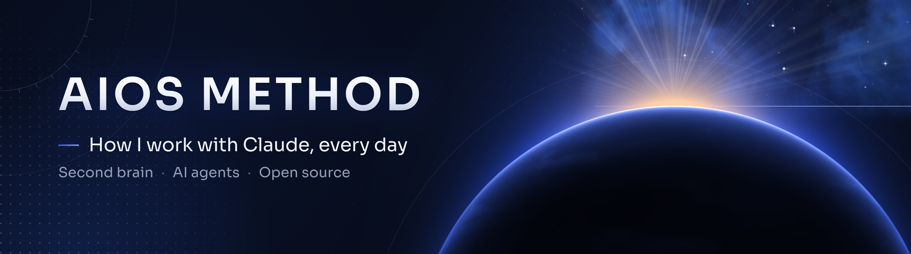
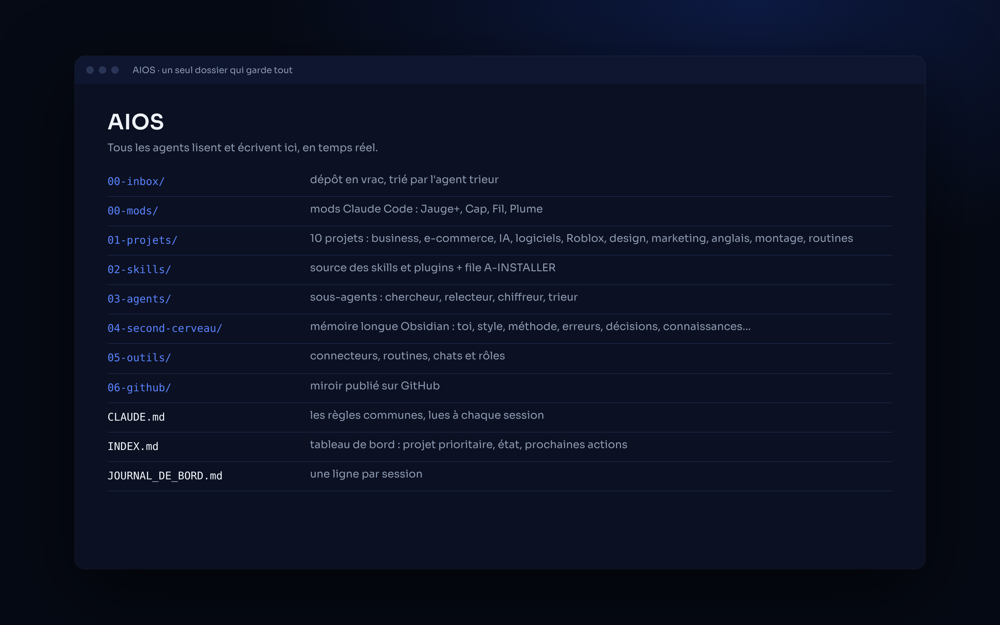
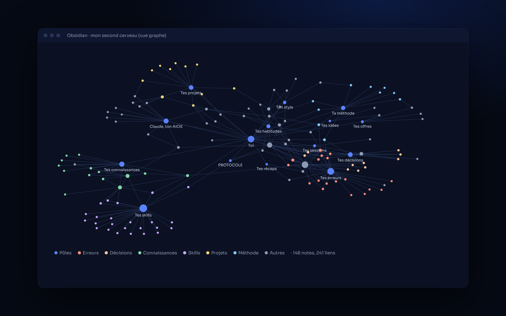
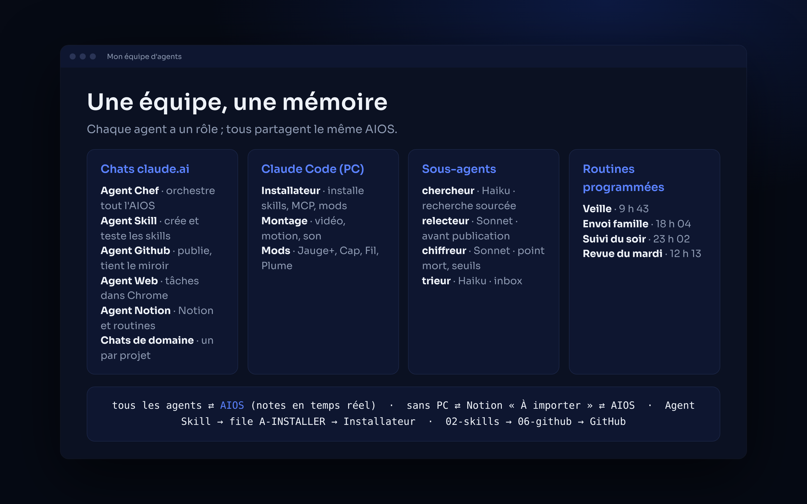
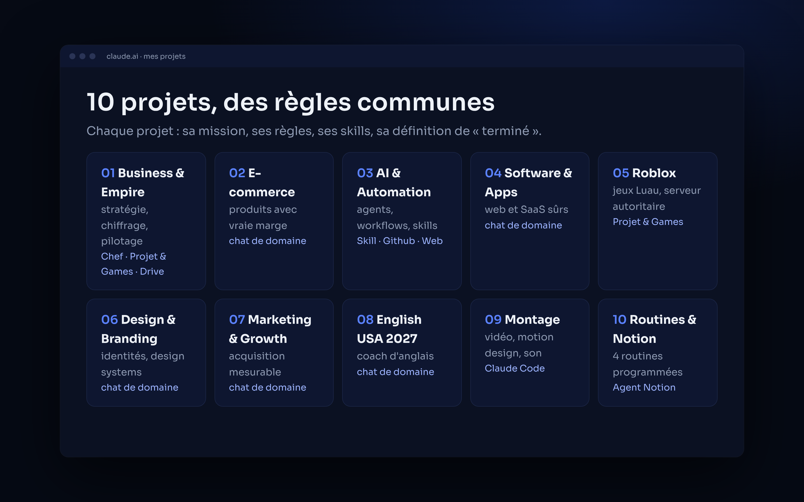

<p align="center">
  
</p>

<p align="center">
  
  
  
</p>

# AIOS Method

**Mon système de travail avec Claude : un second cerveau, une équipe d'agents, des outils maison.**
*My way of working with Claude: one second brain, a team of agents, home-made tools.*

## ✦ AIOS : un seul dossier qui garde tout

Tout ce que je fais avec Claude vit dans un seul dossier, l'**AIOS**. Projets, skills, agents, règles et mémoire au même endroit. Chaque agent le lit au début d'une session et y note, en temps réel, ce qui compte : décisions, erreurs, idées, état du projet.

<p align="center"></p>

```
AIOS/
├── CLAUDE.md            les règles communes, lues à chaque session
├── INDEX.md             tableau de bord : projet prioritaire, état, prochaines actions
├── JOURNAL_DE_BORD.md   une ligne par session
├── 00-inbox/            dépôt en vrac, trié par un agent
├── 00-mods/             mods de l'app Claude Code
├── 01-projets/          01 à 10 : un dossier par projet (CLAUDE.md, STATE.md, DECISIONS.md, a_valider/)
├── 02-skills/           source des skills et plugins
├── 03-agents/           sous-agents
├── 04-second-cerveau/   la mémoire longue (coffre Obsidian)
├── 05-outils/           connecteurs, routines, rôles de chaque chat
└── 06-github/           miroir de ce qui est publié ici
```

**La règle :** tout est noté par tous les agents, au fil de l'eau, sans que j'aie à le demander. Une conversation peut s'arrêter n'importe quand : la suivante reprend exactement là où on en était.

## ✦ Obsidian : le second cerveau

`04-second-cerveau/` est un coffre Obsidian. Chaque note est courte, datée et reliée à son pôle : Toi, Style, Méthode, Projets, Erreurs, Décisions, Connaissances, Sessions, Habitudes, Skills. Aucune note isolée.

<p align="center"></p>

<p align="center"><sub><i>Mon vrai graphe, anonymisé : seuls les pôles sont nommés, les notes personnelles sont retirées.</i></sub></p>

Ce qui le fait vivre :
- **Apprendre des corrections** : chaque erreur devient une note avec la règle pour ne pas la refaire, relue avant d'agir sur le même sujet.
- **Rappels** : au début de chaque session, Claude relit l'état du projet, la dernière session et les erreurs liées. Il ne me redemande jamais ce qui est déjà noté.
- **Consolidation du mardi** : une routine fait le point sur la semaine (temps, blocages, erreurs qui reviennent) et prépare ce qui doit entrer dans le cerveau.

## ✦ Les agents

Chaque agent a un rôle précis. Tous partagent la même mémoire.

<p align="center"></p>

| Où | Agent | Rôle |
|---|---|---|
| Chats claude.ai | Agent Chef | chef d'orchestre : l'AIOS, la mémoire, les décisions, les consignes des autres agents |
| | Agent Skill | crée, améliore et teste skills, plugins et agents ; ne publie jamais |
| | Agent Github | met en forme et publie sur GitHub, tient le miroir |
| | Agent Web | Claude in Chrome : les tâches dans le navigateur |
| | Agent Notion | gère Notion et surveille les routines |
| | Chats de domaine | un par domaine : e-commerce, logiciels, Roblox, design, marketing, anglais |
| Claude Code (sur le PC) | Agent Installateur | installe, met à jour et teste skills, MCP et mods |
| | Agent de montage | vidéo, motion design, son |
| | Développement des mods | Jauge+, Cap, Fil, Plume |
| Sous-agents | chercheur (Haiku) | recherche web sourcée, chiffres étiquetés |
| | relecteur (Sonnet) | relit avant toute publication ou envoi |
| | chiffreur (Sonnet) | business model, point mort, seuils |
| | trieur (Haiku) | trie l'inbox |
| Routines programmées | Veille, Envoi famille, Suivi du soir, Revue du mardi | tournent seules chaque jour ou chaque semaine |

**Comment ils communiquent :**
- Tous lisent et écrivent dans l'AIOS, en temps réel.
- Un agent sans accès au PC (téléphone, web) écrit dans un journal Notion marqué « À importer » ; la prochaine conversation reliée au PC l'importe dans l'AIOS.
- L'Agent Skill passe ce qu'il ne peut pas installer à l'Agent Installateur par une file d'attente (`02-skills/A-INSTALLER.md`).
- Ce qui est prêt dans `02-skills/` est mis en forme dans `06-github/`, puis publié, avec mon accord.

## ✦ Organisation des projets

Un projet claude.ai par domaine. Chacun a sa mission, ses règles, ses skills et sa définition de « terminé », plus un bloc de règles communes identique partout.

<p align="center"></p>

## ✦ Mes outils maison

| Dépôt | En une ligne |
|---|---|
| [memoire-aios](https://github.com/horizonchapter/memoire-aios) | crée ton AIOS et son second cerveau Obsidian |
| [chef-employe](https://github.com/horizonchapter/chef-employe) | déléguer le travail routinier à des sous-agents moins chers, et vérifier |
| [mods-claude-code](https://github.com/horizonchapter/mods-claude-code) | 4 mods pour l'app Claude Code : Jauge+, Cap, Fil, Plume |
| [claude-routines](https://github.com/horizonchapter/claude-routines) | 4 routines programmées qui tiennent Notion à jour |
| [context-transfer](https://github.com/horizonchapter/context-transfer) | reprendre dans un nouveau chat sans rien perdre |
| [chiffrage-projet](https://github.com/horizonchapter/chiffrage-projet) | chiffrer un projet : marge nette, point mort, décision STOP / PIVOT / CONTINUER |
| [checklist-lancement-web](https://github.com/horizonchapter/checklist-lancement-web) | tout vérifier avant de publier un site, une boutique ou un SaaS |
| [grill-me](https://github.com/horizonchapter/grill-me) | se faire interroger pour solidifier un projet avant de le lancer |
| [claude-second-brain](https://github.com/horizonchapter/claude-second-brain) | les modèles CLAUDE.md, STATE.md, DECISIONS.md |
| [pdf-luxe](https://github.com/horizonchapter/pdf-luxe) | des PDF au rendu d'édition haut de gamme |

## ✦ Ma méthode

- **Règle du bouton** : Claude prépare, je valide. Aucune publication, aucun paiement, aucun envoi, aucune création de compte sans mon accord explicite.
- **Un seul projet prioritaire** à la fois. Si je m'éparpille, Claude me le rappelle.
- **Test en 72 h** avant de construire : une hypothèse, un seuil de réussite écrit avant de voir les chiffres.
- **Seuils STOP / PIVOT / CONTINUER** fixés à l'avance, avec une date de décision.
- **Chiffres étiquetés** : VÉRIFIÉ (source datée), ESTIMÉ, HYPOTHÈSE ou INCONNU. Chiffre d'affaires, marge et bénéfice net ne se confondent jamais.
- **Terminé = rangé dans `a_valider/`** : je fais toujours le dernier geste.

## ✦ Reproduire chez soi

Le skill [memoire-aios](https://github.com/horizonchapter/memoire-aios) pose 10 questions et crée toute la structure : dossiers, règles, tableau de bord, second cerveau Obsidian relié. Dis-lui « crée mon AIOS ».

## ✦ Licence

[MIT](LICENSE). Prends ce qui te sert.
